# 雨寂佛都 城市素材包 v0.2

| 项目 | 内容 |
|---|---|
| 内容 | 48 个原版结构文件（建筑 12、寺院 5、佛像与佛龛 10、竖井与坑底 11、街道与广场 10）；卧佛 GeckoLib 模型；4 个自定义方块；普通雨 / 黑雨贴图；10 枚业纹物品；生光特效 |
| 格式 | 原版结构文件，DataVersion 3465（Minecraft 1.20.1） |
| 模组 ID | `qihai`（占位） |
| 来源 | 居民楼、写字楼、商场的楼层来自 The Lost Cities（MIT 许可）并换成雨城材质；医院、店铺、寺院、佛像、竖井、铜钟、街道、卧佛和所有贴图为原创 |
| v0.2 变化 | 画完 12 幅仪式室壁画（第 6 章）；刷怪改为对标《惊变100天》的尸潮规模，怪物数量和特殊怪物都随天数增长，取消特殊怪物的数量限制（第 7 章） |
| v0.1 变化 | 去掉直升机；敲钟后白光一照就直接离开；十佛头不再和离开流程绑定（召唤条件以后单独做） |

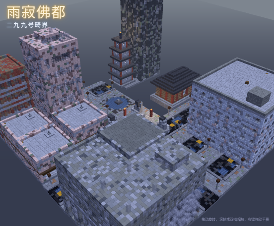

---

## 1. 离开流程（更新）

| 步骤 | 内容 |
|---|---|
| 1 | 在医院病房醒来，外面是普通的灰雨 |
| 2 | 第一个夜晚降临时开始下黑雨，十种怪物全部出现 |
| 3 | 收集 10 枚业纹（每种怪物第一次被击杀时掉落），总击杀达到 50 |
| 4 | 跟着佛像的视线找到城市中心的寺院，从主殿下到竖井底部 |
| 5 | 敲响倒扣的铜钟：横在井口的卧佛开裂、坠落（约 4 秒的演出），钟下透出白光 |
| 6 | 白光照到的玩家直接回到主世界，流程结束 |

条件不满足时敲钟只会发出闷响。

---

## 2. 目录

```
yuji_fodu_city_kit/
├── README.md
├── LICENSE-LostCities-MIT.txt
├── images/
├── data/structure_stats.json
├── structures/
│   ├── buildings/   医院、5 种店铺、4 种居民楼、写字楼、商场
│   ├── temple/      山门、回廊、主殿、佛殿、佛塔
│   ├── statues/     9 尊佛像（3 种体量 × 3 种姿态）、路边佛龛
│   ├── shaft/       井口、5 种竖井段、坑底、铜钟、3 间仪式室（已装好壁画）
│   └── streets/     8 种街道（含公交站、佛龛路段）、2 种广场
└── assets/qihai/
    ├── geo/、animations/、textures/entity/   卧佛模型 + 生光光柱贴图
    ├── blockstates/、models/block/、textures/block/   香炉、壁尸、壁画（12 幅 × 9 块）、生光
    ├── textures/environment/   rain_grey.png、rain_black.png
    ├── textures/particle/、particles/   黑色水花、生光粒子
    ├── textures/item/、models/item/、items/   10 枚业纹
    └── lang/   zh_cn.json、en_us.json
```

放置路径同永夜都市素材包：1.20.x 放 `data/qihai/structures/`。

---

## 3. 建筑

| 文件 | 名称 | 尺寸 | 说明 |
|---|---|---|---|
| `hospital` | 旧医院（2×2） | 32×30×32 | 5 层：中间走廊、两侧病房（病床、床头柜、隔帘）、护士站；西端梯子贯通到天台；天台有水箱和首次进入时的补给桶（`chests/yuji_supply_drop`，对应原著"自选物资"）；外立面红十字 |
| `shop_grocery` / `shop_tea` | 杂货铺 / 茶楼 | 16×18×16 | 3 层；一楼卷帘门和中文招牌（告示牌文字） |
| `shop_pharmacy` / `shop_noodle` / `shop_hardware` | 大药房 / 面馆 / 五金店 | 16×13×16 | 2 层；楼顶有一尊小佛像 |
| `res_tile_low` / `res_tile_mid` | 白瓷砖居民楼 | 16×37 / 49×16 | 老式白瓷砖外墙 |
| `res_brick` | 红砖筒子楼 | 16×37×16 | 红砖、泥砖混砌 |
| `res_concrete_high` | 混凝土高层 | 16×67×16 | 10 层，绮语怪的楼顶 |
| `office_rain` | 写字楼 | 16×55×16 | |
| `mall_rain` | 商场（2×2） | 32×31×32 | 妄语怪的主场 |

| 医院 | 大药房 | 白瓷砖居民楼 |
|---|---|---|
| 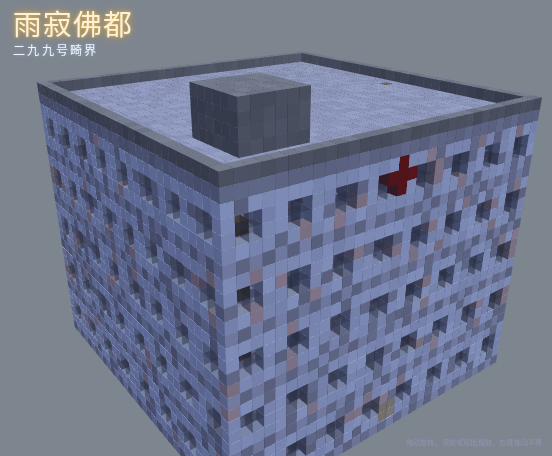 | 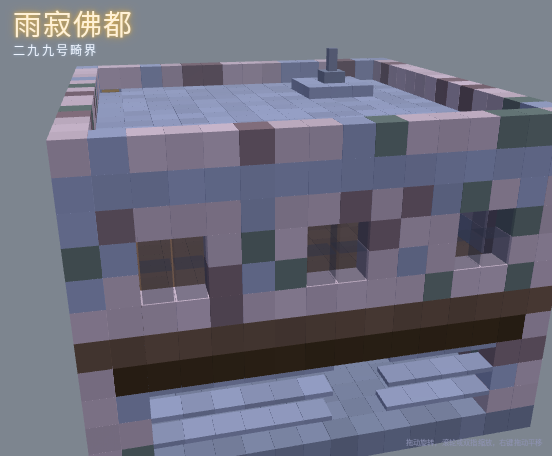 | 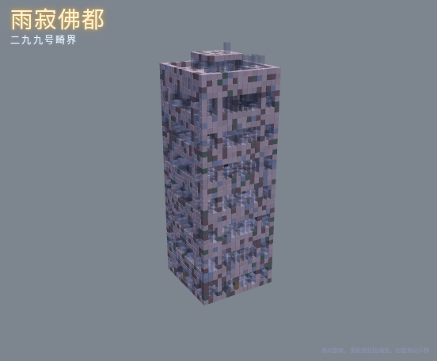 |

---

## 4. 寺院与佛像

| 文件 | 名称 | 尺寸 | 说明 |
|---|---|---|---|
| `temple_gate` | 山门 | 20×14×9 | 4 格宽的铁门，对应原著的"金属大门"；重檐 |
| `cloister_straight` | 回廊 | 16×7×5 | 可首尾相接围成院落 |
| `main_hall` | 主殿 | 48×20×48 | 罩在竖井正上方，中间是直径 40 的井口和一圈栏杆，屋顶中央留天井让雨落进竖井 |
| `temple_hall` | 佛殿 | 24×15×16 | 台基、红柱、格窗、重檐，殿内一尊中坐佛 |
| `pagoda` | 佛塔 | 11×32×11 | 五层 |

| 主殿 | 佛殿 | 佛塔 | 山门 |
|---|---|---|---|
| 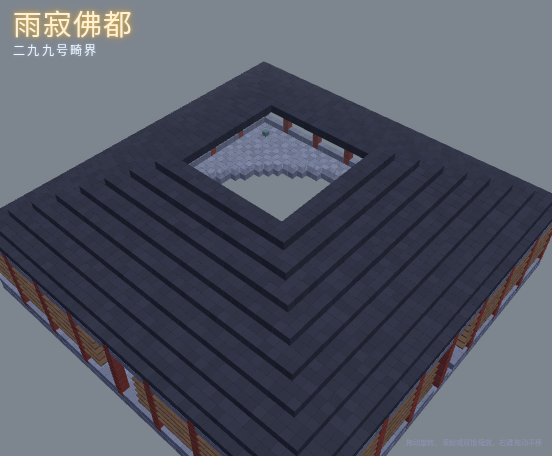 | 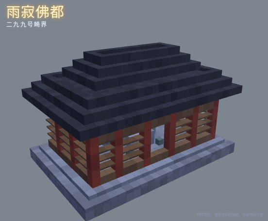 | 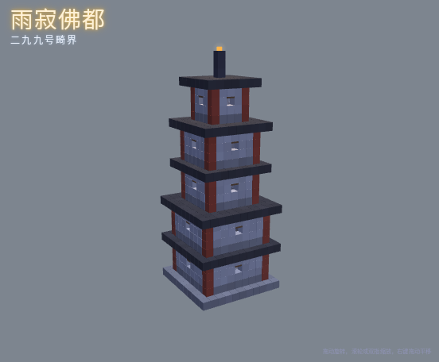 | 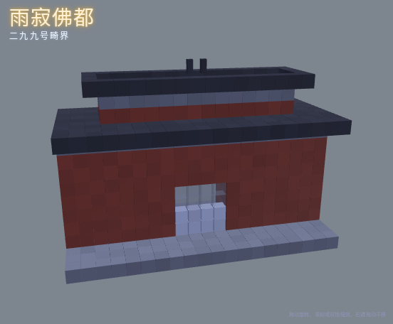 |

**佛像**（结构正面朝北，生成时按"朝向城市中心"旋转）：

| 体量 | 坐佛 | 立佛 | 半身佛 |
|---|---|---|---|
| 小（2–3 格） | 3×2×3 | 1×3×1 | 3×2×3 |
| 中（9 格） | 10×9×8 | 7×9×6 | 10×9×9 |
| 大（19 格） | 20×19×16 | 12×19×11 | 20×19×17 |

中、大体量有闭目的双眼、白毫、嘴和深色肉髻；半身佛像是从地里长出来的巨大头像，周围有一圈碎裂的地面。`roadside_shrine`（5×6×4）是路边佛龛：小坐佛、蜡烛、香炉。

| 大坐佛 | 大立佛 | 大半身佛 | 路边佛龛 |
|---|---|---|---|
| 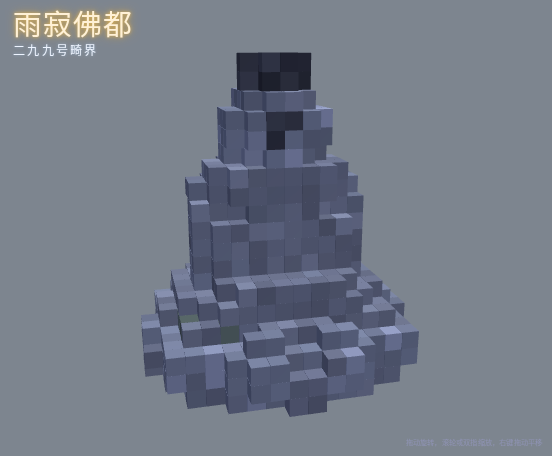 | 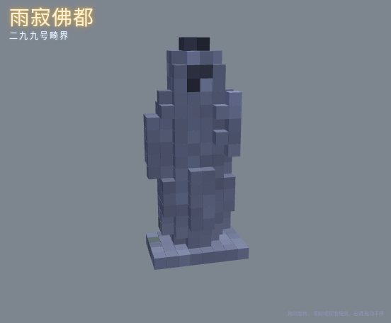 | 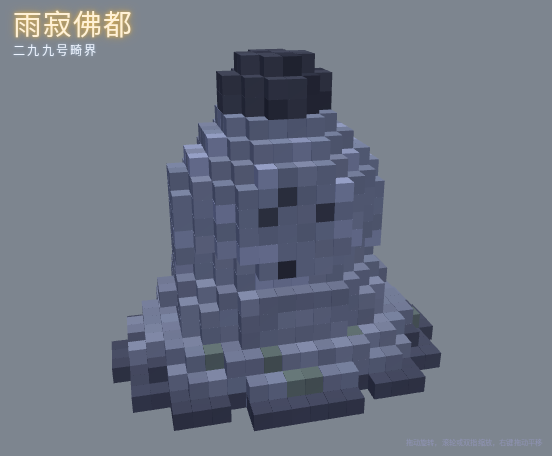 | 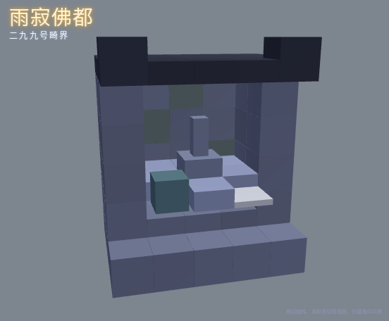 |

---

## 5. 中心竖井：众佛共视之处

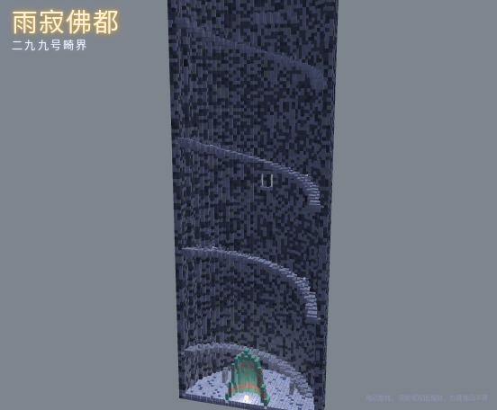

从上到下依次拼接（总深约 140 格）：

| 文件 | 尺寸 | 说明 |
|---|---|---|
| `main_hall` | 48×20×48 | 罩在井口上的主殿 |
| `shaft_mouth` | 48×16×48 | 井口段：东西两条托梁，卧佛实体横放在 y=11 的梁上 |
| `shaft_section_plain` | 48×16×48 | 普通段 |
| `shaft_section_niche` / `_niche_b` | 48×16×48 | 带两处壁龛（小佛像、蜡烛、香炉）和更多壁尸 |
| `shaft_section_ritual` | 48×16×48 | 深度 7 处有朝 180° 的门洞，仪式室接在井壁外侧 |
| `shaft_section_elevator` | 48×16×48 | 带一节坏掉的升降机轿厢 |
| `shaft_bottom` | 64×24×64 | 坑底：积水地面、8 个排水口、4 块碑、台阶终点、升降机底部、朝 +X 的侧洞（小车、棺箱、平台） |
| `bronze_bell` | 15×17×15 | 倒扣的铜钟，放在坑底正中；钟口下有生光的发光点 |
| `ritual_room_karma` | 15×7×15 | 十恶业室：四面墙共 10 幅壁画，正中一尊中坐佛 |
| `ritual_room_soul` / `_golden_buddha` | 11×7×11 | 正对门的墙上各一幅主壁画 |

**螺旋台阶**：宽 3 格，沿井壁每段转半圈（每 32 格转一整圈），用"整块 + 半砖"交替做出平缓的坡道，内侧是铁栏杆。每一段的台阶角度都按它在栈里的位置计算好，按上表顺序叠放就能首尾相接。

**升降机**：固定在 0° 方向、距中心 13 格处，四根铁链从井口一直垂到坑底；对应原著"升降机""悬索"。

| 坑底 | 倒扣铜钟 | 升降机段 | 仪式室（剖开） |
|---|---|---|---|
| 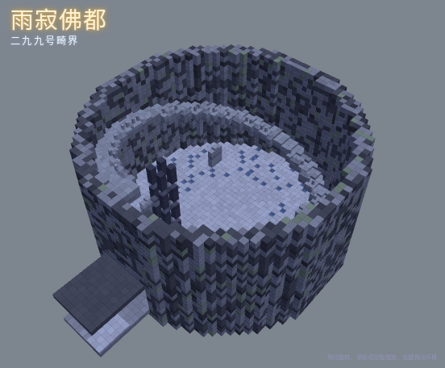 | 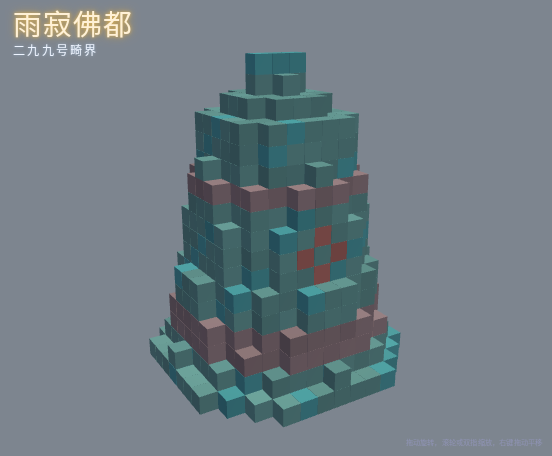 | 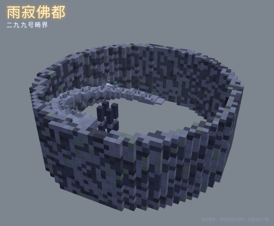 | 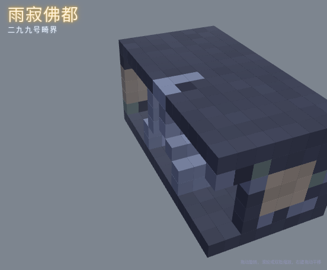 |

**卧佛**（`geo/reclining_buddha.geo.json`）：按半尺寸建模，渲染时放大 2 倍约 40 格长；蓝色底座、并拢的双腿、托着头的右手、闭目的佛面。动画：`idle` 静止、`crack` 开裂抖动（1.6 秒）、`fall` 东端先断并翻落（3 秒，下落距离由实体运动负责）、`rest` 落地后的姿态。

| 横在井口 | 坠落中 |
|---|---|
| 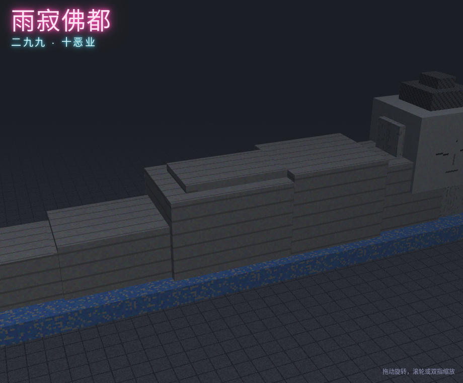 | 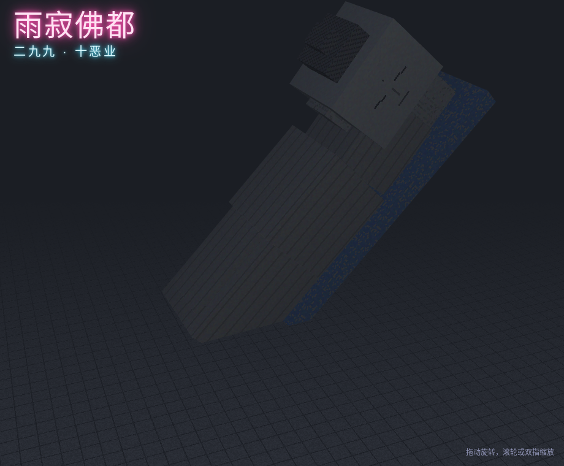 |

---

## 6. 街道、天气与小物件

**街道**：8 格宽的柏油路夹着泥浆，两侧石砖人行道带青苔；每块路面随机 3–6 个积水坑（四周都是方块，水不会流出）；排水格栅、不亮的路灯、黄色车道线。`street_busstop` 带公交站，`street_shrine` 的人行道上有路边佛龛。`plaza_incense` 是寺前香炉广场，`plaza_flooded` 是一大片浅水中间露出一尊半身佛。

| 公交站 | 积水广场 | 演示街区（黑雨） |
|---|---|---|
| 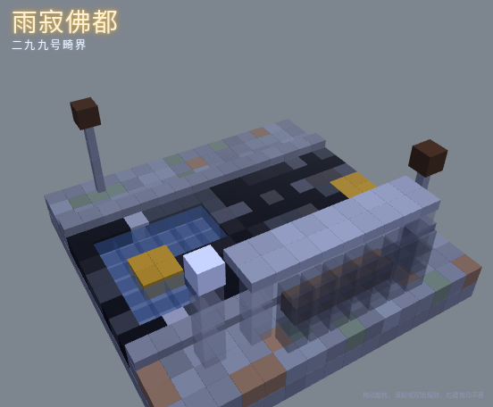 | 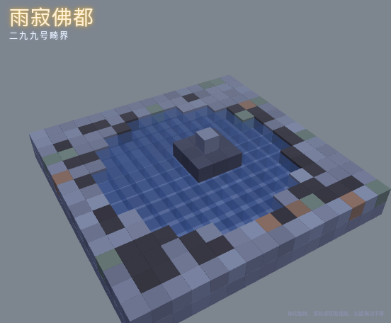 | 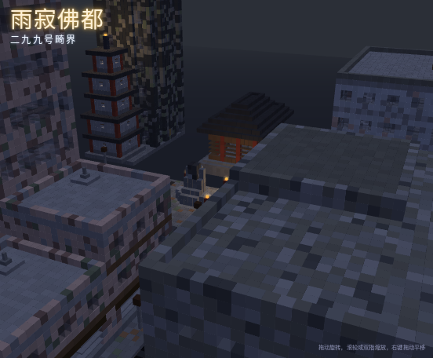 |

**两种雨境的颜色**：

| 项 | 普通雨 | 黑雨 |
|---|---|---|
| 天空颜色 | `#6E7680` | `#2B2F37` |
| 雾颜色 | `#7D858F` | `#23262C` |
| 雾距离 | 64 格 | 32 格 |
| 雨滴贴图 | `environment/rain_grey.png` | `environment/rain_black.png` |
| 水花粒子 | 原版 | `qihai:black_splash` |

雨滴贴图和原版 `environment/rain.png` 同为 64×256，自定义天气渲染里按雨境切换即可。

**自定义方块**（需要机制侧按以下 ID 和属性注册）：

| 方块 ID | 属性 | 说明 |
|---|---|---|
| `qihai:incense_burner` | 无 | 青铜三足香炉（带元素的方块模型） |
| `qihai:wall_corpse` | `facing`、`part`（lower / upper） | 壁尸：墙缝里的人形暗影，两格高，不做血腥细节 |
| `qihai:mural` | `facing`、`mural`、`tile` | 壁画方块，见 6.5 节 |
| `qihai:holy_light_source` | 无 | 铜钟下的生光发光点，建议平时亮度 0、敲钟后 15 |

**业纹**：10 个物品 `qihai:karma_mark_<怪物>`，图案取自对应怪物身上的纹样（汇顶纹、残缺莲花、残缺法轮、嘴角忍冬纹、喉部佛眼、扭绞的辐条、璎珞死结、颌颈花纹、缺蕊莲花、怒睁佛眼）。


**生光**：`particles/holy_light.json`（4 帧暖白光点）和 `textures/entity/holy_light_beam.png`（从钟口向上的光柱）。

---

## 6.5 仪式室壁画

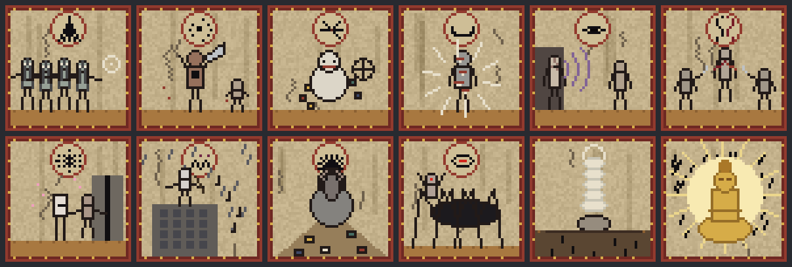

12 幅原创壁画，每幅 48×48 像素、占 3×3 个方块。风格是被雨水泡旧的寺庙壁画：泛黄的灰泥底、竖向的水渍和裂纹、暗红描金的边框；十恶业的每一幅顶部都有一枚对应的业纹圆牌，画面取自那种怪物的特征。

| 壁画 | 画面 | 位置 |
|---|---|---|
| 愚痴 | 一群失神的人跟着一点光，纹路汇向头顶 | 十恶业室 1 |
| 杀生 | 与刀长在一起的手臂，胸口贯通的黑洞 | 十恶业室 2 |
| 偷盗 | 抱着一堆东西的怪婴，旁边是残缺的法轮 | 十恶业室 3 |
| 恶口 | 满身是嘴的人，四射的白骨刺 | 十恶业室 4 |
| 妄语 | 熔化的脸发出一圈圈声音，引着听的人走向暗处 | 十恶业室 5 |
| 两舌 | 吐出两条舌头的人，两个同伴互相举起刀 | 十恶业室 6 |
| 邪淫 | 甜香里的人被牵向墙缝（躯体做抽象处理） | 十恶业室 7 |
| 绮语 | 楼顶吹箫的人，墨色的音符飘下（人物推测的形象） | 十恶业室 8 |
| 贪欲 | 层层叠着人脸的老人，坐在囤积的物资和尸骨上 | 十恶业室 9 |
| 嗔怒 | 六足巨物身前嵌着怒目的男人 | 十恶业室 10 |
| 容器 | 白色的魂从躯壳中升起，黑色的业坠入地底 | 白魂黑业室 |
| 真佛 | 金色坐佛放出光，驱散黑雨 | 金佛驱雨室 |

**十恶业室的阅读顺序**：进门后从右手边的墙开始，顺时针一路看过去，最后一幅"嗔怒"在门旁边。

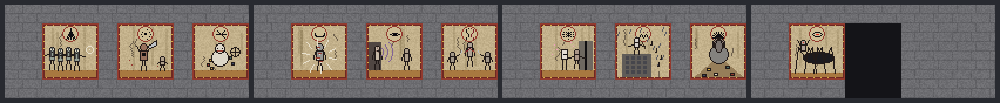

（从左到右：右墙、正对门的墙、左墙、门所在的墙，都是站在屋里看到的样子）

**方块**：`qihai:mural`，属性 `facing`（north / east / south / west，壁画朝向）、`mural`（12 种：yuchi、shasheng、toudao、ekou、wangyu、liangshe、xieyin、qiyu、tanyu、chennu、soul、golden_buddha）、`tile`（0–8，从观看者看到的左上角起，按行编号）。方块状态文件已经写好 432 种组合。

---

## 7. 刷怪：尸潮随天数增长

目标对标《惊变100天》的规模：一开始就不少，越往后越多；特殊怪物不设数量上限，只随天数变强变多。v0.1 里的"精神类同屏上限"和"嗔怒怪区域上限"都取消了。

### 7.1 天数

- 雨寂佛都里的一天和原版一样是 20 分钟，从玩家进入时开始计。
- **第 0 天**：进入到第一个夜晚之前，普通雨，只有愚痴、杀生、偷盗。
- **第 1 天**起：黑雨，十种怪物全部出现，之后每过一天难度上一个台阶。
- 天数按玩家各自计算；多人时取在场玩家里最大的天数。

### 7.2 怪物上限与刷新速度

| 项 | 公式 | 说明 |
|---|---|---|
| 每名玩家周围的怪物上限 | 第 0 天 30；第 1 天 60；之后每天 +25，封顶 300 | 夜间上限 ×1.5 |
| 刷新距离 | 24–96 格 | 比原版远，形成"四面八方涌来"的感觉 |
| 刷新速度 | 每秒尝试次数 = 当前上限 ÷ 20 | 上限越高刷得越快 |
| 群体大小 | 基础群体 × (1 + 0.15 × 天数) | 第 5 天的愚痴怪一群能到 3–5 只 |

### 7.3 特殊怪物（不限数量，按天数加权）

| 怪物 | 第 1 天权重 | 每天增长 | 第 5 天 | 第 10 天 |
|---|---|---|---|---|
| 愚痴怪 | 28 | 不变 | 28 | 28 |
| 杀生怪 | 16 | +1 | 20 | 25 |
| 偷盗怪 | 10（夜间 ×2） | 不变 | 10 | 10 |
| 贪欲怪（3–5 只一群） | 12 | +1.5 | 18 | 25.5 |
| 恶口怪 | 8 | +35% | 19.2 | 33.2 |
| 妄语怪 | 7 | +35% | 16.8 | 29.1 |
| 两舌怪 | 6 | +35% | 14.4 | 24.9 |
| 邪淫怪 | 5 | +35% | 12 | 20.8 |
| 绮语怪 | 2 | +35% | 4.8 | 8.3 |
| 嗔怒怪 | 每 256×256 区域 1 只 | 每 2 天 +1 只 | 3 只 | 5 只 |

特殊怪物（恶口、妄语、两舌、邪淫、绮语）的权重公式：基础权重 × (1 + 0.35 × (天数 − 1))。随着天数推移，普通怪物的占比下降、特殊怪物越来越常见。

### 7.4 夜间尸潮

| 项 | 规则 |
|---|---|
| 时机 | 每个夜晚降临时，对每名玩家各发动一次 |
| 规模 | 30 + 20 × 天数（第 1 天 50、第 5 天 130、第 10 天 230） |
| 组成 | 愚痴 55%、杀生 25%、偷盗 5%、特殊怪物 15%（这部分按 7.3 的权重抽） |
| 行为 | 在玩家 64–96 格外分几路生成，一开始就知道玩家的位置，向玩家合围 |
| 大尸潮 | 每第 3 个夜晚规模 ×2，并额外加入每名玩家 1 只嗔怒怪和 2 群贪欲怪 |
| 和愚痴怪的联动 | 尸潮里的愚痴怪同样有"探测灯"效果，会把沿途的其他怪物带过来 |
| 尸潮不占上限 | 尸潮生成的怪物不计入 7.2 的上限，避免挤掉日常刷新 |

### 7.5 怪物属性成长

| 项 | 规则 |
|---|---|
| 生命值、攻击力 | 每天 +5%，第 20 天封顶 +100% |
| 移动速度 | 每 5 天 +5%，封顶 +15% |
| 贪欲怪初始人皮层数 | 1 + 天数 ÷ 3（向下取整），封顶 6 层 |

### 7.6 天数进度速查

| 天数 | 上限（白天 / 夜间） | 夜间尸潮 | 特殊怪物权重倍率 | 嗔怒怪 / 256² | 属性加成 |
|---|---|---|---|---|---|
| 0 | 30 / 45 | — | — | 0 | 0% |
| 1 | 60 / 90 | 50 | ×1.0 | 1 | +5% |
| 2 | 85 / 128 | 70 | ×1.35 | 1 | +10% |
| 3 | 110 / 165 | 180（大尸潮） | ×1.7 | 2 | +15% |
| 5 | 160 / 240 | 130 | ×2.4 | 3 | +25% |
| 7 | 210 / 300 | 170 | ×3.1 | 4 | +35% |
| 10 | 285 / 300 | 230 | ×4.15 | 5 | +50% |
| 15 | 300 / 300 | 660（大尸潮） | ×5.9 | 8 | +75% |

### 7.7 保留的规则

- **位置限制不变**：贪欲怪在地下、两舌怪在楼里、邪淫怪在小房间或窄处、绮语怪在高楼顶。
- **城区倍率不变**：

| 城区 | 倍率 |
|---|---|
| 医院区 | 愚痴 ×2，偷盗 ×1.5 |
| 旧城街区 | 杀生 ×1.5，恶口 ×1.5，两舌 ×1.5 |
| 商场区 | 妄语 ×3 |
| 地铁 | 贪欲 ×4，其他 ×0.5 |
| 寺庙区 | 邪淫 ×1.5，绮语 ×1.5 |

- **竖井内部**：不自然刷新，但尸潮的怪物会跟着玩家下井；每间仪式室固定 1 只邪淫怪，坑底固定 7 只白袍愚痴怪（原著第 196 章），敲钟时消失。
- **保护期**：刚进入的病房 16 格内 3 分钟不刷怪。
- **敲钟之后**：停止一切刷新，白光照到即离开。

### 7.8 性能

几百只怪物同时存在对服务器压力很大。建议机制侧把以下数值做成配置项：上限封顶值（默认 300）、尸潮规模倍率、刷新距离；并对 96 格外、不属于尸潮的怪物启用快速消失。

---

## 8. 已知问题

- **螺旋台阶的接缝**：每段的台阶按深度连续计算，但段与段之间如果用了不同的旋转方向会错开，必须按第 5 章的顺序、相同朝向叠放。
- **体素佛像**：中、大体量佛像是用几何体素化生成的，轮廓偏圆润，近看会有阶梯感；如果需要更精细的佛像，可以交给社区手工修。
- **建筑内部陈设**：医院、店铺是原创的完整内饰；居民楼和写字楼沿用 Lost Cities 的楼层布局，内部比较空。

---

## 9. 来源与许可

- 居民楼、写字楼、商场的楼层布局改造自 The Lost Cities（McJty，MIT 许可），许可证原文见 `LICENSE-LostCities-MIT.txt`。
- 其余结构、模型和贴图为本项目原创。
