# 雨寂佛都 怪物图鉴 v0.2

| 项目 | 内容 |
|---|---|
| 奇界 | 雨寂佛都（原著 299 号畸界） |
| 原著依据 | 《畸海浮城》第 121–212 章，以 2026-10-11 整理的原文资料为准；第 212 章主角提交的十类怪物问卷是最重要的归类依据 |
| 内容 | 十恶业怪物 10 种 + 最终存在十佛头 + 恶口怪的骨刺弹射物，共 12 个模型；动作、攻击特效、音效、刷怪蛋、Boss 战曲、奇界环境音 |
| 目标版本 | Minecraft 1.20.1 Forge + GeckoLib 4 |
| 本版不含 | 刷新机制、十佛头的召唤条件（只做刷怪蛋） |
| v0.2 变更 | 按 MC 单人玩法重做恶口、妄语、两舌、邪淫、贪欲五种怪物的机制（见第 2 章）；新增 3 个状态效果及图标、4 种特效、4 个音效；贪欲怪改为最多显示 6 层人脸并新增吞噬动画；恶口怪新增受伤爆刺动画 |
| 来源标注 | 每张卡都标明“原著”或“二创”。原著没写的数值和技能一律算二创 |

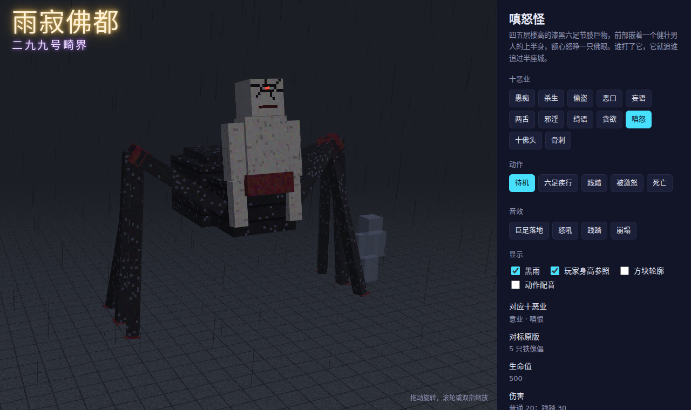

---

## 1. 总表

| 怪物 | 十恶业 | 对标原版 | 生命 | 伤害 | 移速 | 核心机制 | 来源 |
|---|---|---|---|---|---|---|---|
| 愚痴怪 | 意业 · 愚痴 | 僵尸（不攻击） | 30 | 0（不攻击） | 0.18 | 不攻击，跟随并当“探测灯” | 原著 |
| 杀生怪 | 身业 · 杀生 | 手持锋利 II 刀刃的僵尸 | 20 | 每刀 3，一次连砍两刀（僵尸 3 + 刀刃 1.5 + 锋利 II 1.5） | 0.30（奔跑） | 冲锋连斩 | 原著 |
| 偷盗怪 | 身业 · 偷盗 | 小僵尸（更快） | 12 | 1 | 0.42（小僵尸约 0.35） | 偷东西，杀死才掉落 | 原著 |
| 恶口怪 | 口业 · 恶口 | 僵尸 + 远程 | 24 | 咒缚每 1.5 秒 1–3（无视护甲）；骨刺每根 3 | 0.25 | 咒缚持续掉血 + 招怒 + 受伤爆刺 | 原著 |
| 妄语怪 | 口业 · 妄语 | 僵尸 + 干扰 | 20 | 3 | 0.23 | 熟人的假声音 + 虚弱 | 原著 |
| 两舌怪 | 口业 · 两舌 | 僵尸 + 离间 | 16 | 2 | 0.23 | 众叛：友善生物敌视你，怪物更狂暴 | 原著 |
| 邪淫怪 | 身业 · 邪淫 | 僵尸 + 迷魂 | 20 | 0（无手，不直接攻击）；窄处挤压每秒 2 | 0.20 | 听见就被慢慢拉过去，窄处挤压 | 原著（外形做了抽象化处理） |
| 绮语怪 | 口业 · 绮语（人物推测） | 僵尸 + 二创机制 | 20 | 4 | 0.25（滑行，不受摔落伤害） | 箫声盖住怪物的声音 | 二创（原著只闻箫声、未见本体） |
| 贪欲怪 | 意业 · 贪心 | 成长型僵尸（成群） | 30 + 层数 × 4（初始 2 层为 38，满 12 层为 78） | 4 + 层数 × 0.5（满层为 10） | 0.25；8 格内冲刺 0.34 | 击杀叠皮：越杀越肉、越疼 | 原著 |
| 嗔怒怪 | 意业 · 嗔恨 | 5 只铁傀儡 | 500 | 普通 20；践踏 30 | 0.38（很快） | 中立，被打后永久记仇 | 原著 |
| 十佛头 | 十恶业之上（最终存在） | 奇界最终 Boss | 2000 | 巨臂砸地 50 + 冲击波 20；横扫 40；碾压每秒 10 | 0.30（巨臂拖行，可攀墙） | 极高减伤，巨臂砸地 | 原著外形 + 二创数值 |

**和你最初描述的对应关系**：“呆”是愚痴怪；拿刀的“怒”在原著里其实是杀生怪；巨型的“暴怒”是嗔怒怪（六足，不是八足蜘蛛）；“偷东西的婴儿”是偷盗怪；“大佛头”是十佛头。

---

## 2. MC 专项设计：精神类能力怎么落地

原著里恶口、妄语、两舌、邪淫的能力大多是“影响队友”的精神干扰，但 MC 大部分时候是单人游玩。这一版把它们改成两类效果：直接作用在玩家身上的状态效果，以及改变玩家和周围生物关系的连锁效果。贪欲怪则改成靠击杀成长的怪物。

### 2.1 新增状态效果


| 效果 | ID | 来源 | 等级 | 作用 | 怎么解除 |
|---|---|---|---|---|---|
| 迷魂 | `qihai:enthralled` | 邪淫怪 | I–III，在范围内每 3 秒升一级 | 被慢慢拉向邪淫怪（每秒 0.8 / 1.4 / 2.0 格），II 级起视角被转向它，反方向移动只有 40% 速度；II 级起在两侧是方块的窄处每秒受 2 点挤压伤害 | 受到其他来源的伤害立即清零；按住潜行 2 秒降一级（冷却 6 秒）；离开 16 格；杀死邪淫怪。牛奶无效 |
| 众叛 | `qihai:betrayed` | 两舌怪 | 单级，20 秒，可刷新 | 友善与中立生物把你当成怪物；32 格内的敌对生物直接锁定你，移速、攻击 +30%，追踪距离翻倍 | 等待结束；杀死施加它的两舌怪。牛奶无效 |
| 咒缚 | `qihai:cursed` | 恶口怪 | 伤害随停留时间增长 | 每 1.5 秒 1 点魔法伤害（无视护甲），每多待 5 秒 +0.5，最高 3 点；每 2 秒把 32 格内的敌对生物引向你，并给它们速度 I | 离开 12 格范围 3 秒后清零；杀死恶口怪。牛奶无效 |
| 虚弱（原版） | `minecraft:weakness` | 妄语怪 | I / II | 每听到一次假声音 8 秒虚弱 I；看向假声源升为 II；连续 3 次没找到它则虚弱 II 持续 20 秒 | 原版规则（牛奶可解），杀死妄语怪也会解除 |

三个新效果都设为牛奶喝不掉，逼玩家去找源头；这需要在 Forge 里把它们的“可治愈物品”列表设为空。

### 2.2 众叛期间原版生物的反应

| 生物 | 反应 | 结束后 |
|---|---|---|
| 铁傀儡、雪傀儡 | 把你设为攻击目标 | 放弃目标 |
| 村民、流浪商人 | 像躲僵尸一样躲你，无法交易 | 恢复正常 |
| 野狼、蜜蜂、羊驼、北极熊、山羊、熊猫 | 对你进入愤怒状态（羊驼吐口水、山羊冲撞） | 愤怒计时结束后恢复 |
| 你驯服的狼 | 对你龇牙并攻击 | 恢复驯服状态，不会丢失 |
| 你驯服的猫、鹦鹉 | 不再跟随，原地不动 | 恢复跟随 |
| 32 格内的敌对生物 | 不需要看见你就锁定你；移速、攻击 +30%；追踪距离翻倍 | 移除加成，按原版逻辑决定是否继续追 |

### 2.3 设计取舍

- **都给了解法**：每个精神类效果都能靠找到并杀死源头来解除，同时都有一个不用杀怪的办法（离开范围、等待、潜行挣脱、挨一下打）。
- **两舌怪和恶口怪是“连锁型”**：它们本身不难打，危险来自它们把周围的生物都变成你的敌人，所以本体都设计得比较脆（16 / 24 点生命）。
- **邪淫怪的危险来自地形**：它不攻击，伤害来自你被拖进窄处后的挤压。在开阔地带遇到它反而不致命，这和原著“躲在厕所隔间、墙缝”的设定一致。
- **贪欲怪的成长有上限**：12 层封顶；同伴死亡时只有最近的一只能吞，避免一群互相喂养无限膨胀；重击会剥皮，给了反制手段。

### 2.4 实现要点（Forge 1.20.1）

| 怪物 | 要点 |
|---|---|
| 两舌怪 | 众叛生效时每 20 tick 扫描一次 32 格：傀儡直接设攻击目标；中立生物走原版“持久愤怒”接口；村民加一个躲避目标；驯服的狼临时以主人为目标，并记一个标记用于结束后恢复；敌对生物设目标并加临时属性修饰符（移速、攻击、追踪距离），效果结束时移除。头顶红纹用 `qihai:betray_mark` 粒子 |
| 恶口怪 | 咒缚的持续伤害写在效果的每 tick 回调里（魔法伤害源）；招怒每 40 tick 一次；受伤爆刺监听受伤事件，冷却 20 tick，向 8 个方向发射 `bone_spike` 弹射物 |
| 邪淫怪 | 服务端每 tick 给玩家加一个指向邪淫怪的速度分量（按等级缩放），检测玩家速度方向与牵引方向的夹角来施加“反方向减速”；视角转向通过发包让客户端插值；窄处判断为脚部和头部高度的左右或前后两侧都是实心方块 |
| 贪欲怪 | 层数存为同步数据；层数变化时重算最大生命和攻击的属性修饰符，并在受伤事件里按层数减伤；击杀判定监听死亡事件；渲染器按层数显示 `layer_1`–`layer_6` 骨骼，并整体缩放 `1 + 0.02 × 层数` |
| 妄语怪 | 假声音只发给目标玩家（客户端音效包），声源取玩家周围 6–10 格内墙后的随机位置；“被骗”的判定是 2 秒内玩家视线与假声源方向夹角小于 15° |

### 2.5 建议的配置项

| 配置项 | 默认值 | 说明 |
|---|---|---|
| `betrayed.affectPets` | `true` | 众叛是否让驯服的狼攻击主人 |
| `betrayed.affectVillagers` | `true` | 众叛是否让村民躲避玩家 |
| `betrayed.hostileBuff` | `0.3` | 敌对生物的移速和攻击加成 |
| `enthralled.pullStrength` | `1.0` | 迷魂牵引强度倍率，容易晕动的玩家可以调低 |
| `enthralled.cameraTurn` | `true` | 迷魂是否转动玩家视角 |
| `cursed.maxDamage` | `3` | 咒缚每次伤害的上限 |
| `tanyu.maxLayers` | `12` | 贪欲怪层数上限 |

---

## 3. 愚痴怪（Delusion Husk）

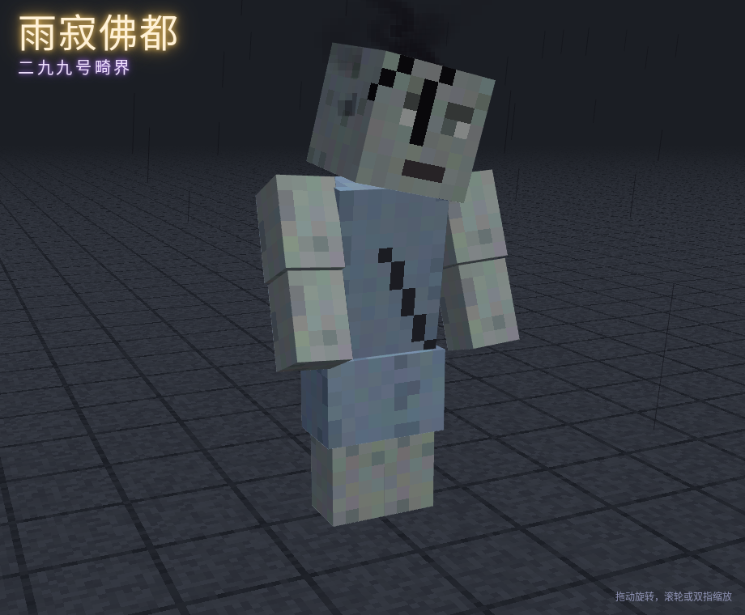

> 穿着湿透病号服的普通人，眼睛半睁却失焦。它不会攻击你，只是一直跟着，而且越跟越近。

| 项 | 值 |
|---|---|
| 注册 ID | `qihai:yuchi` |
| 对应十恶业 | 意业 · 愚痴 |
| 对标原版 | 僵尸（不攻击） |
| 生命值 | 30 |
| 伤害 | 0（不攻击） |
| 移速 | 0.18 |
| 护甲 | 2 |
| 碰撞箱 | 0.6 × 1.95 格 |
| 刷怪蛋颜色 | 底色 `#96AAB6`，斑点 `#B0B6A8` |
| 来源标注 | 原著 |

### 机制

- 不主动攻击任何玩家。
- 看见玩家后静默跟随，跟随距离从 6 格逐步缩到 1 格，会堵路、挡视线。
- 探测灯：移动中的愚痴怪被其他怪物看见时，那些怪物会跟上来，并把它正在跟随的玩家设为目标——即使它们自己还没发现玩家。
- 残躯：生命值低于 30% 时改为爬行（移速 0.08），仍然继续跟随。
- 关着的门能挡住它（不会开门）。

### 原著依据

普通市民体型与衣着，病号服个体潮湿浮肿；眼睛半睁失焦，头发稀疏；身上的黑色模糊纹样汇向天灵盖。不主动攻击，看见活人后静默跟随，可持续很久；锁上的门能挡住它们。严重破损后仍可能爬行。（第127、129、131、212章）

### 美术资源

| 资源 | 内容 |
|---|---|
| 模型 | `geo/yuchi.geo.json`：10 根骨骼、9 个方块；贴图 128×128 |
| 动画 | `idle` 待机；`walk` 拖步；`stare` 盯着你；`crawl` 残躯爬行；`death` 死亡 |
| 攻击 / 技能特效 | 待机 第 0.3 秒：业力黑烟（`karma_wisp`）；盯着你 第 0.2 秒：业力黑烟（`karma_wisp`） |
| 音效 | 湿重的呼吸（`yuchi/ambient.ogg`，3.2 秒）；拖步水声（`yuchi/step.ogg`，0.7 秒）；受伤（`yuchi/hurt.ogg`，0.4 秒）；倒地（`yuchi/death.ogg`，1.25 秒） |

---

## 4. 杀生怪（Killing Blade）

| 外观 | 动作 |
|---|---|
| 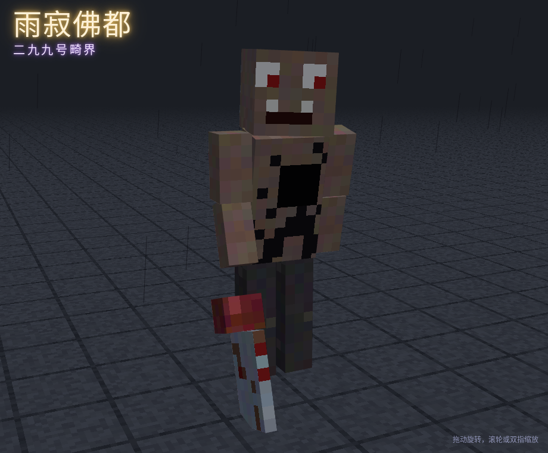 | 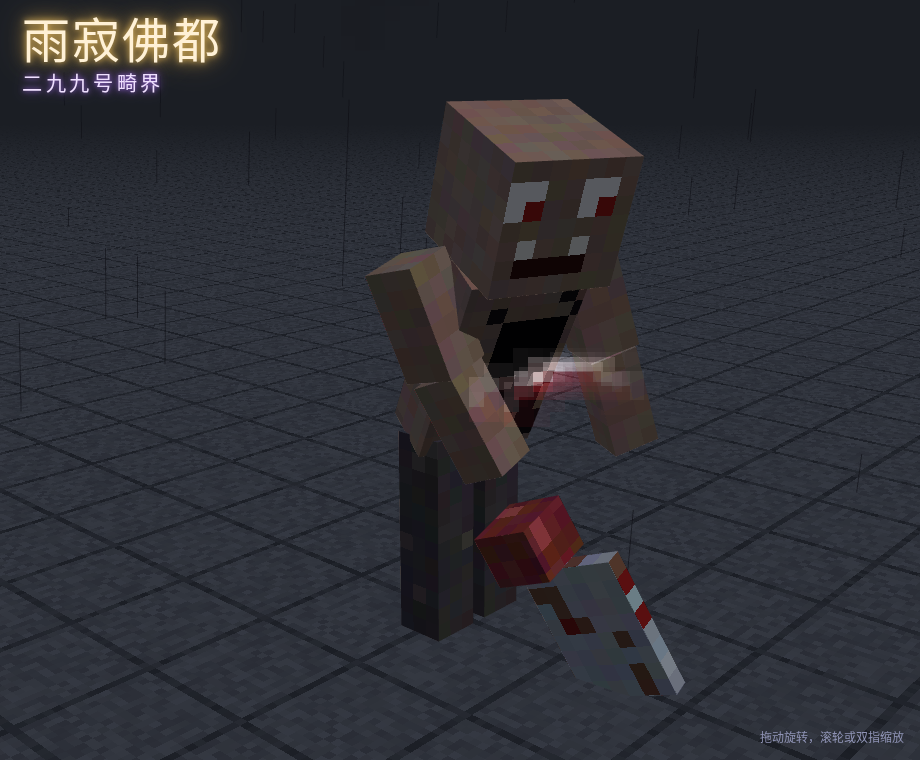 |

> 右手和菜刀长在一起的男人，胸口心脏位置有一个前后贯通的黑洞。发现活物就冲上来，专砍脖子。

| 项 | 值 |
|---|---|
| 注册 ID | `qihai:shasheng` |
| 对应十恶业 | 身业 · 杀生 |
| 对标原版 | 手持锋利 II 刀刃的僵尸 |
| 生命值 | 20 |
| 伤害 | 每刀 3，一次连砍两刀（僵尸 3 + 刀刃 1.5 + 锋利 II 1.5） |
| 移速 | 0.30（奔跑） |
| 护甲 | 2 |
| 碰撞箱 | 0.6 × 1.95 格 |
| 刷怪蛋颜色 | 底色 `#806656`，斑点 `#8E2020` |
| 来源标注 | 原著 |

### 机制

- 发现玩家就直线冲锋，奔跑速度明显快于僵尸。
- 连斩：一次攻击连砍两刀，第 0.3 秒和第 0.6 秒各结算一次。
- 痛觉迟钝：击退抗性 0.3，被击中不会停下脚步。

### 原著依据

成年偏瘦、紧绷的裸上身男性；右手与菜刀等利器皮肉增生融合，刀柄像被肉包住；胸口心脏处有切缘规整的贯通黑洞，洞周有残缺莲花与断裂忍冬纹。发现生命就冲锋追砍，瞄准颈部连续斩击，步枪击中躯干后仍会短暂停顿继续追杀。（第130、131、188、212章）

### 美术资源

| 资源 | 内容 |
|---|---|
| 模型 | `geo/shasheng.geo.json`：10 根骨骼、10 个方块；贴图 128×128 |
| 动画 | `idle` 待机；`run` 冲锋；`chop` 连斩；`death` 死亡 |
| 攻击 / 技能特效 | 连斩 第 0.28 秒：刀光（`blade_slash`）；连斩 第 0.58 秒：刀光（`blade_slash`） |
| 音效 | 粗重喘息（`shasheng/ambient.ogg`，2.0 秒）；连斩（`shasheng/chop.ogg`，1.1 秒）；闷哼（`shasheng/hurt.ogg`，0.35 秒）；死亡（`shasheng/death.ogg`，1.65 秒） |

---

## 5. 偷盗怪（Thieving Infant）

| 外观 | 动作 |
|---|---|
| 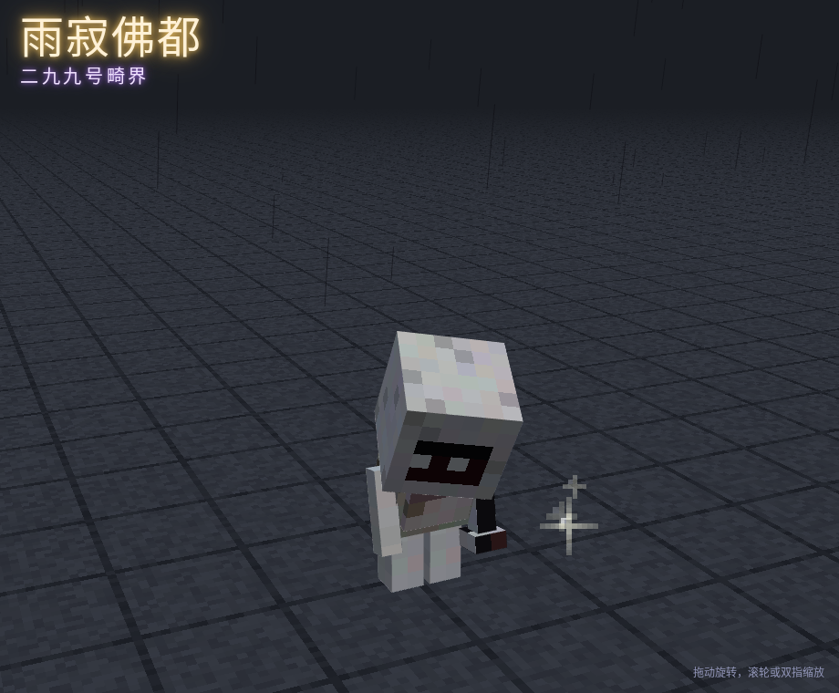 | 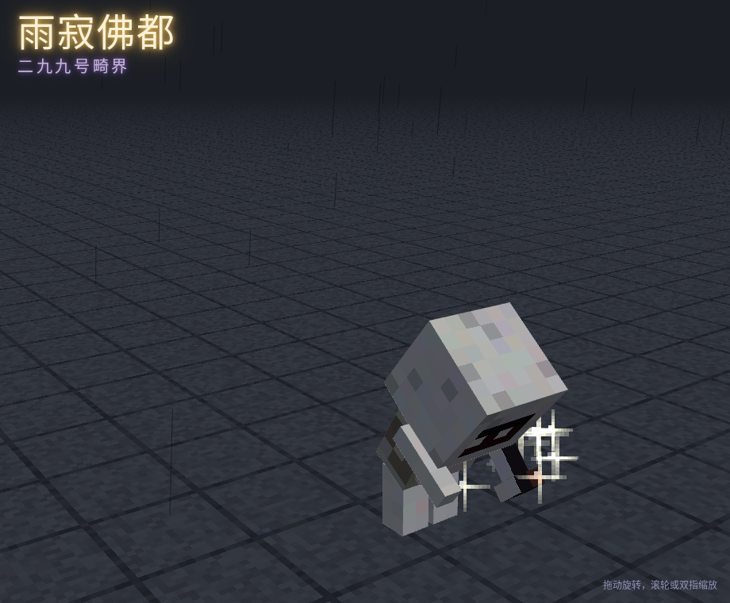 |

> 惨白干瘪的怪婴，左掌是少了三根辐条的法轮。它不想杀你，只想拿走你最在乎的东西。

| 项 | 值 |
|---|---|
| 注册 ID | `qihai:toudao` |
| 对应十恶业 | 身业 · 偷盗 |
| 对标原版 | 小僵尸（更快） |
| 生命值 | 12 |
| 伤害 | 1 |
| 移速 | 0.42（小僵尸约 0.35） |
| 护甲 | 0 |
| 碰撞箱 | 0.5 × 0.7 格 |
| 刷怪蛋颜色 | 底色 `#D6D0C4`，斑点 `#101012` |
| 来源标注 | 原著 |

### 机制

- 偷窃：每次攻击命中，从玩家背包里拿走一组物品（优先附魔物品和稀有物品，从不碰已穿戴的护甲），偷到后转身逃跑 10 秒。
- 偷到的东西挂在它手上，只有杀死它才会掉落。
- 尖啸：受到伤害时尖叫，8 格内的玩家获得 3 秒反胃。
- 动作极轻：移动不发出脚步声。

### 原著依据

一两岁婴孩体量，四肢细小、皮肤惨白干瘪，穿脏污短袖婴儿服和围兜；左掌法轮少三根辐条、轴心凹陷；牙齿尖硬到能啃自己的骨头。行动极轻极快，专偷持有者重视的物品；被抓后扑咬，发出刺痛耳膜的尖啸。（第138、139、140、212章）

### 美术资源

| 资源 | 内容 |
|---|---|
| 模型 | `geo/toudao.geo.json`：9 根骨骼、8 个方块；贴图 64×64 |
| 动画 | `idle` 蹲伏；`scuttle` 飞快爬行；`snatch` 扑抢；`scream` 尖啸；`death` 死亡 |
| 攻击 / 技能特效 | 扑抢 第 0.28 秒：抢夺闪光（`snatch_glint`）；尖啸 第 0.15 秒：尖啸声波（`scream_ring`） |
| 音效 | 细碎的咯咯声（`toudao/ambient.ogg`，1.15 秒）；抢走东西（`toudao/steal.ogg`，0.5 秒）；尖啸（`toudao/scream.ogg`，1.1 秒）；死亡（`toudao/death.ogg`，0.7 秒） |

---

## 6. 恶口怪（Cursing Mouth）

| 外观 | 动作 |
|---|---|
| 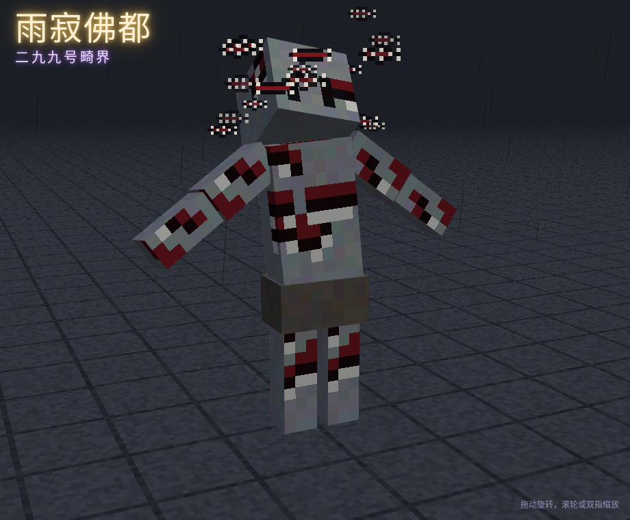 | 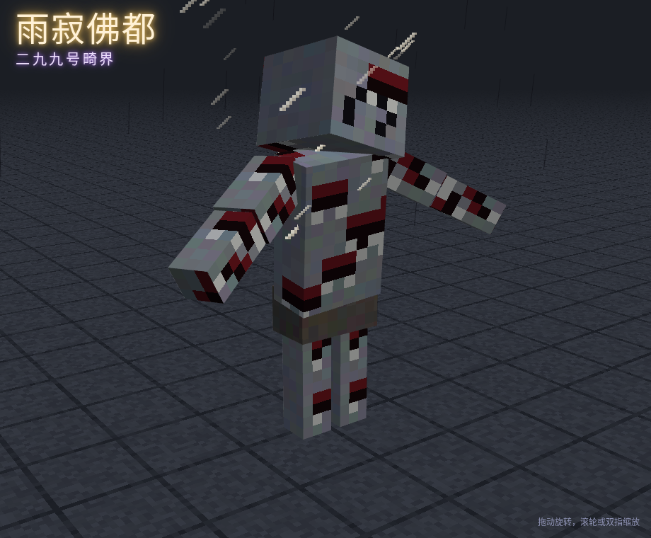 |

> 全身裂满嘴状伤口的灰白人形。走近它，脑子里会响起层层叠叠的辱骂；惹到它，它会喷出一片骨刺。

| 项 | 值 |
|---|---|
| 注册 ID | `qihai:ekou` |
| 对应十恶业 | 口业 · 恶口 |
| 对标原版 | 僵尸 + 远程 |
| 生命值 | 24 |
| 伤害 | 咒缚每 1.5 秒 1–3（无视护甲）；骨刺每根 3 |
| 移速 | 0.25 |
| 护甲 | 2 |
| 碰撞箱 | 0.6 × 1.95 格 |
| 刷怪蛋颜色 | 底色 `#888A88`，斑点 `#6E141A` |
| 来源标注 | 原著 |

### 机制

- 咒缚：12 格内（隔墙生效）的玩家获得“咒缚”，每 1.5 秒受到 1 点魔法伤害，无视护甲；在范围内每多待 5 秒伤害 +0.5，最高 3 点；离开范围 3 秒后清零。
- 招怒：带着咒缚的玩家会把 32 格内的敌对生物都引过来（不需要看见你），这些怪物获得速度 I。
- 受伤爆刺：每次受到伤害（冷却 1 秒）向四周炸出 8 根骨刺，每根 3 点伤害——近战打它一定会被扎。
- 骨刺齐射：16 格内能看见目标时，每 8 秒向前方 30° 扇形射出 5 根骨刺。
- 应对：咒缚隔墙也有效，躲不掉，只能尽快用远程武器把它打掉。

### 原著依据

偏瘦裸体人形，灰白发暗，全身多条裂开的嘴状伤口，面部尤重；嘴角左右有断裂忍冬纹。多人会同时在脑内感知咒骂，捂耳无效；遭挑衅或开枪后会齐射大量尖锐白骨刺。（第141、142、143、188、212章）

### 美术资源

| 资源 | 内容 |
|---|---|
| 模型 | `geo/ekou.geo.json`：10 根骨骼、9 个方块；贴图 128×128 |
| 动画 | `idle` 抽动念叨；`walk` 踉跄；`curse` 咒骂；`spike_volley` 骨刺齐射；`claw` 抓击；`burst` 受伤爆刺；`death` 死亡 |
| 攻击 / 技能特效 | 咒骂 第 0.3 秒：咒骂口纹（`curse_glyph`）；咒骂 第 0.5 秒：咒缚光环（`curse_aura`）；受伤爆刺 第 0.16 秒：骨刺碎片（`bone_shard`）；骨刺齐射 第 0.55 秒：骨刺碎片（`bone_shard`） |
| 音效 | 层叠的咒骂（`ekou/curse.ogg`，2.85 秒）；骨刺齐射（`ekou/volley.ogg`，0.9 秒）；受伤（`ekou/hurt.ogg`，0.4 秒）；死亡（`ekou/death.ogg`，1.5 秒）；受伤爆刺（`ekou/burst.ogg`，0.5 秒） |

---

## 7. 妄语怪（False Voice）

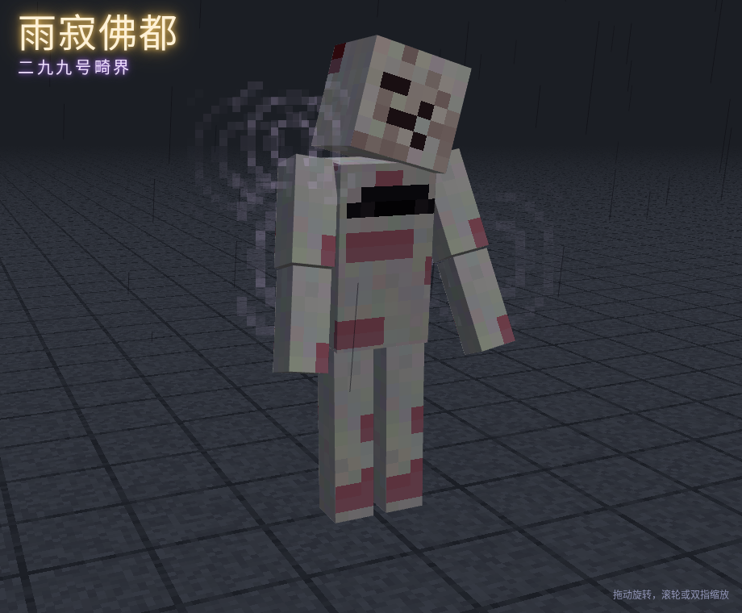

> 脸像热蜡一样熔成一团，喉咙上长着一只半睁的佛眼。它躲在暗处，用你熟人的声音叫你。

| 项 | 值 |
|---|---|
| 注册 ID | `qihai:wangyu` |
| 对应十恶业 | 口业 · 妄语 |
| 对标原版 | 僵尸 + 干扰 |
| 生命值 | 20 |
| 伤害 | 3 |
| 移速 | 0.23 |
| 护甲 | 0 |
| 碰撞箱 | 0.6 × 2.1 格 |
| 刷怪蛋颜色 | 底色 `#C6BAA8`，斑点 `#96505A` |
| 来源标注 | 原著 |

### 机制

- 熟人之声：24 格内，每 6–10 秒只对它锁定的那名玩家播放一次假声音——原版的开门、开箱、脚步、村民受伤、狼的呜咽、玩家受伤声，声源在你身边的墙后。
- 动摇：每听到一次获得 8 秒虚弱 I；如果你转头看向假声音的方向（被骗到了），升为虚弱 II。
- 连续 3 次都没找到它：虚弱 II 持续 20 秒。
- 它躲在暗处，与你保持 8–12 格，你转身时才靠近；杀死它后虚弱立即解除。

### 原著依据

瘦削人体，遍身长而深的口状裂创，创内有薄膜般的组织；脸像蜡热熔，五官混为一团；喉部是瞳孔扩散、半睁半闭的黑色佛眼纹。在暗处制造熟人、死者的喊声，诱导目标转向、深入或迟疑；开枪击中本体后幻听解除。（第153、154、168–171、212章）

### 美术资源

| 资源 | 内容 |
|---|---|
| 模型 | `geo/wangyu.geo.json`：10 根骨骼、8 个方块；贴图 128×128 |
| 动画 | `idle` 待机；`walk` 潜行；`mimic` 拟声；`claw` 抓击；`death` 死亡 |
| 攻击 / 技能特效 | 拟声 第 0.2 秒：拟声涟漪（`voice_ripple`） |
| 音效 | 熟人的呼唤（`wangyu/mimic.ogg`，1.9 秒）；喉部咔哒声（`wangyu/ambient.ogg`，1.6 秒）；受伤（`wangyu/hurt.ogg`，0.3 秒）；死亡（`wangyu/death.ogg`，1.35 秒） |

---

## 8. 两舌怪（Two-Tongue）

| 外观 | 动作 |
|---|---|
| 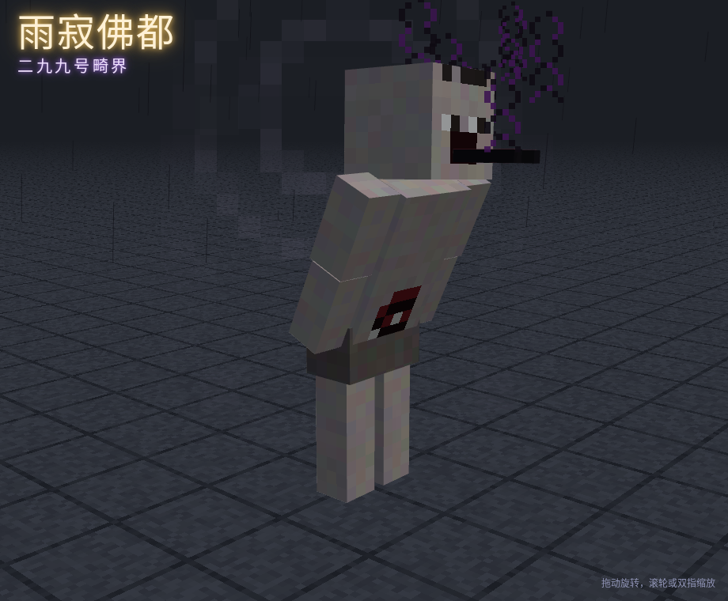 | 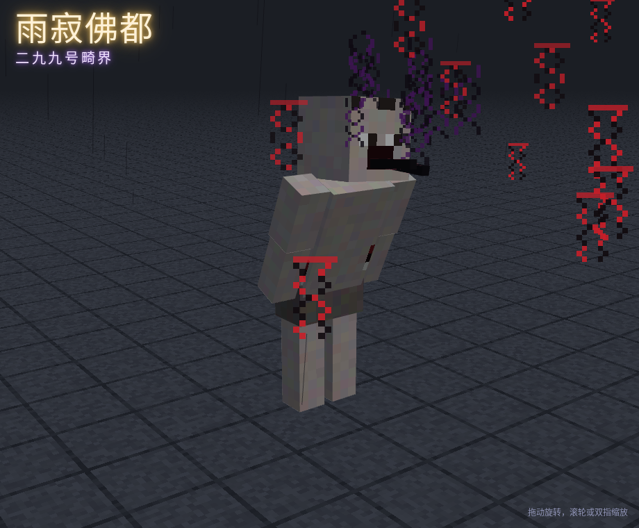 |

> 瘦弱的男人，嘴里是两条并排的完整舌头，舌面纹着扭成麻花的法轮辐条。它躲在屋里，让你们互相怀疑。

| 项 | 值 |
|---|---|
| 注册 ID | `qihai:liangshe` |
| 对应十恶业 | 口业 · 两舌 |
| 对标原版 | 僵尸 + 离间 |
| 生命值 | 16 |
| 伤害 | 2 |
| 移速 | 0.23 |
| 护甲 | 0 |
| 碰撞箱 | 0.6 × 1.6（弓背） 格 |
| 刷怪蛋颜色 | 底色 `#B4A696`，斑点 `#B04654` |
| 来源标注 | 原著 |

### 机制

- 离间：每 15 秒对 20 格内的玩家施加“众叛” 20 秒（隔墙生效，持续期间再次施加会刷新时长）。
- 众叛——友善与中立生物把你当成怪物：铁傀儡、雪傀儡主动攻击你；村民和流浪商人见你就逃，无法交易；野狼、蜜蜂、羊驼、北极熊、山羊、熊猫对你敌对；你驯服的狼会对你龇牙攻击、猫不再跟随（效果结束后恢复，不会丢失宠物）。
- 众叛——怪物更狂暴：32 格内的敌对生物会直接锁定你（不需要看见），获得移速 +30%、攻击伤害 +30%，追踪距离翻倍。
- 被它离间的生物头顶冒出红黑扭纹。
- 喝牛奶解不掉；杀死这只两舌怪会立即解除它施加的所有众叛。
- 本体很弱（16 点生命），总躲在屋里不露脸；它的低语声是找到它的唯一线索。

### 原著依据

瘦弱裸体男性，头发稀疏，身上嘴状伤痕比恶口怪少，五官正常；口中是两条并排、各自完整的舌头（不是舌尖分叉），舌面黑色法轮辐条扭绞成麻花。从附近平房施加影响，使队友出现强烈疑惧乃至向同伴开枪。（第173、174、188、212章）

### 美术资源

| 资源 | 内容 |
|---|---|
| 模型 | `geo/liangshe.geo.json`：13 根骨骼、11 个方块；贴图 128×128 |
| 动画 | `idle` 蹲伏；`walk` 移动；`whisper` 离间；`scratch` 抓挠；`death` 死亡 |
| 攻击 / 技能特效 | 离间 第 0.3 秒：离间扭纹（`discord_twist`）；离间 第 0.9 秒：众叛红纹（`betray_mark`） |
| 音效 | 两条舌头的低语（`liangshe/whisper.ogg`，2.4 秒）；受伤（`liangshe/hurt.ogg`，0.25 秒）；死亡（`liangshe/death.ogg`，1.15 秒）；众叛（`liangshe/betray.ogg`，1.7 秒） |

---

## 9. 邪淫怪（Luring Body）

| 外观 | 动作 |
|---|---|
| 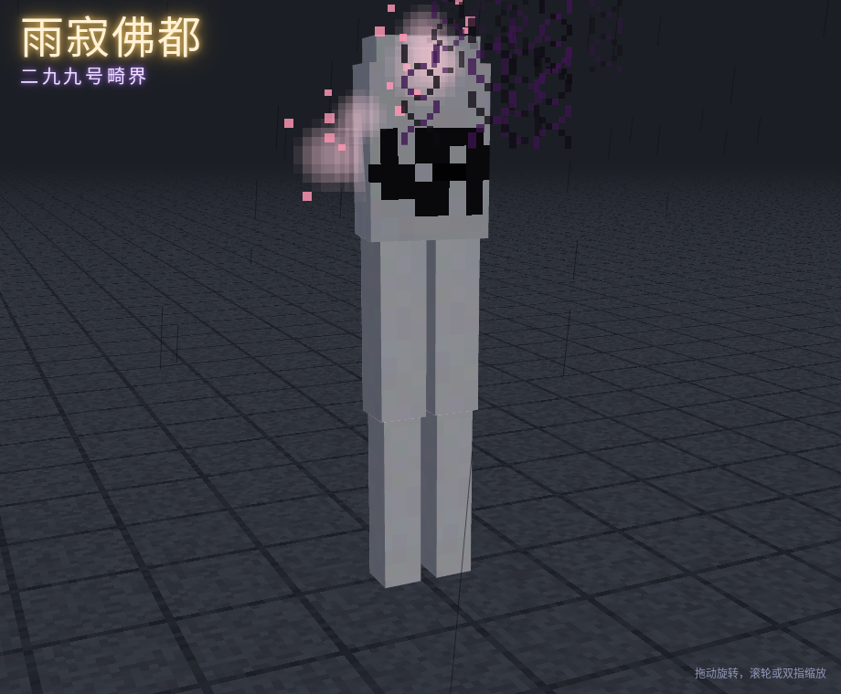 | 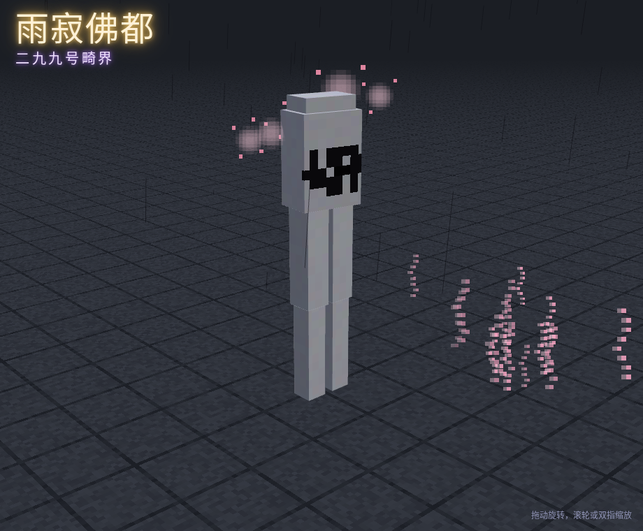 |

> 苍白、修长、没有头也没有手臂的躯体，肩线以上自然闭合。它从不碰你，只让你自己往墙缝里挤。

| 项 | 值 |
|---|---|
| 注册 ID | `qihai:xieyin` |
| 对应十恶业 | 身业 · 邪淫 |
| 对标原版 | 僵尸 + 迷魂 |
| 生命值 | 20 |
| 伤害 | 0（无手，不直接攻击）；窄处挤压每秒 2 |
| 移速 | 0.20 |
| 护甲 | 0 |
| 碰撞箱 | 0.6 × 2.1 格 |
| 刷怪蛋颜色 | 底色 `#E2DCD6`，斑点 `#141216` |
| 来源标注 | 原著（外形做了抽象化处理） |

### 机制

- 听见即中招：它每 4 秒发出一次甜腻的低鸣，16 格内听到的玩家（隔墙生效）获得“迷魂”，在范围内每 3 秒加深一级，最高 III 级。
- 牵引：迷魂期间你会被慢慢拉向它，越来越近（I / II / III 级每秒 0.8 / 1.4 / 2.0 格）；II 级起视角也会被缓慢转向它；往反方向走只有 40% 的速度。
- 挤压：它总躲在狭窄的地方（厕所隔间、墙缝）；迷魂 II 级以上时，你身处两侧都是方块的窄处会每秒受到 2 点挤压伤害——这就是原著里被拖进墙缝的死法。
- 惊醒：受到任何其他来源的伤害，迷魂立即清零；按住潜行 2 秒可以降一级（冷却 6 秒）；离开 16 格或杀死它也会解除。
- 缩腿：被 4 格内的玩家正视时缩起双腿，3 秒内停止低鸣——这是反击窗口。

### 原著依据

无头、无肩、无臂的苍白修长躯体，肩线以上由完整皮肤自然闭合，腹部有多重缠绕打死结的黑色璎珞珠链纹；被发现时受惊会缩腿。接近者会被诱导失去对疼痛和危险的判断，把身体挤向狭窄锋利的墙缝，造成严重伤亡；同伴拍打、强行拖离可使人清醒。（第180–183、188、212章）

### 美术资源

| 资源 | 内容 |
|---|---|
| 模型 | `geo/xieyin.geo.json`：6 根骨骼、6 个方块；贴图 64×64 |
| 动画 | `idle` 静立；`walk` 迈步；`curl` 缩腿；`lure` 迷魂；`death` 死亡 |
| 攻击 / 技能特效 | 迷魂 第 0.1 秒：甜腻香雾（`sweet_haze`）；迷魂 第 0.4 秒：牵引丝线（`lure_pull`）；静立 第 1.0 秒：甜腻香雾（`sweet_haze`） |
| 音效 | 甜腻的低鸣（`xieyin/lure.ogg`，4.4 秒）；受伤（`xieyin/hurt.ogg`，0.3 秒）；倒下（`xieyin/death.ogg`，0.9 秒）；被牵引（`xieyin/pull.ogg`，2.4 秒） |

> 外形处理说明：按原著保留“无头、无肩、无臂、修长、苍白、腹部璎珞死结纹”这些识别特征，躯体做成没有任何身体细节的抽象方块造型。

---

## 10. 绮语怪（Rooftop Flute）

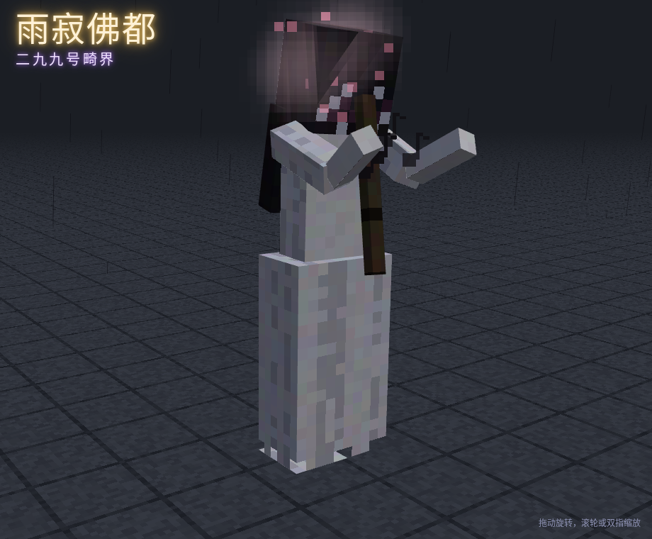

> 原著里只有黑雨中楼顶传来的箫声，演奏者从未露面。这里的外形和能力都是二创：一个披着破旧长袍、在屋顶吹箫的修长身影。

| 项 | 值 |
|---|---|
| 注册 ID | `qihai:qiyu` |
| 对应十恶业 | 口业 · 绮语（人物推测） |
| 对标原版 | 僵尸 + 二创机制 |
| 生命值 | 20 |
| 伤害 | 4 |
| 移速 | 0.25（滑行，不受摔落伤害） |
| 护甲 | 0 |
| 碰撞箱 | 0.6 × 2.3 格 |
| 刷怪蛋颜色 | 底色 `#CEC8C4`，斑点 `#141216` |
| 来源标注 | 二创（原著只闻箫声、未见本体） |

### 机制

- 箫声（二创）：32 格内，其他怪物发出的声音被箫声盖住（音量降低 70%），玩家很难听到怪物靠近。
- 常待在高处屋顶，玩家靠近时滑行下来近战。
- 原著唯一确认的是持续的箫声，没有任何受害记录；以上机制均为二创。

### 原著依据

黑雨时约十多层楼高的屋顶方向传来连绵的笛/箫声，远离后逐渐变弱；人物推测演奏者属于绮语怪，但始终未正面见到。没有任何外形、攻击和受害记录。（第155、187、188、212章）

### 美术资源

| 资源 | 内容 |
|---|---|
| 模型 | `geo/qiyu.geo.json`：9 根骨骼、9 个方块；贴图 128×128 |
| 动画 | `idle_play` 吹箫；`glide` 滑行；`strike` 撞击；`death` 死亡 |
| 攻击 / 技能特效 | 吹箫 第 0.6 秒：墨色音符（`ink_note`）；吹箫 第 2.2 秒：墨色音符（`ink_note`） |
| 音效 | 箫声（`qiyu/flute.ogg`，14.86 秒）；受伤（`qiyu/hurt.ogg`，0.2 秒）；死亡（`qiyu/death.ogg`，2.9 秒） |

---

## 11. 贪欲怪（Greed Hoarder）

| 外观 | 动作 |
|---|---|
| 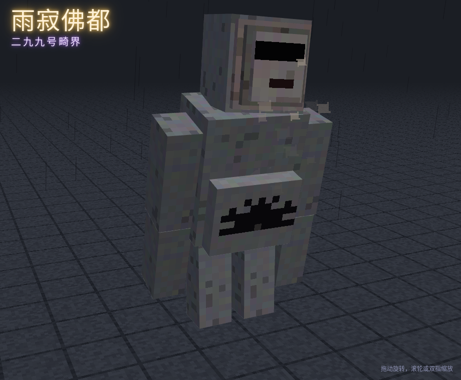 | 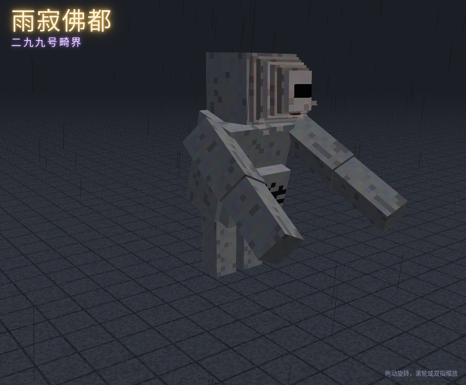 |

> 两米多高的灰皮老人，脑袋切开是十几层叠在一起的人皮，像洋葱一样。它们成群待在地铁里，囤积物资和尸体。

| 项 | 值 |
|---|---|
| 注册 ID | `qihai:tanyu` |
| 对应十恶业 | 意业 · 贪心 |
| 对标原版 | 成长型僵尸（成群） |
| 生命值 | 30 + 层数 × 4（初始 2 层为 38，满 12 层为 78） |
| 伤害 | 4 + 层数 × 0.5（满层为 10） |
| 移速 | 0.25；8 格内冲刺 0.34 |
| 护甲 | 4 |
| 碰撞箱 | 0.9 × 2.7（随层数变大） 格 |
| 刷怪蛋颜色 | 底色 `#84827E`，斑点 `#3A3634` |
| 来源标注 | 原著 |

### 机制

- 叠皮：初始 2 层人皮（刷怪蛋随机 1–3 层），最多 12 层。
- 每一层：最大生命 +4（同时回复 4 点）、受到的伤害 -4%（最多 -48%）、攻击 +0.5（最多 +6）、体型 +2%；8 层以上移速 -10%。
- 吞噬叠层：每击杀一个生物（动物、村民、其他怪物、玩家都算）+1 层；同伴死亡时，8 格内离得最近的那只贪欲怪会扑上去吞掉它，+3 层——先杀谁很重要。
- 剥皮：单次受到 6 点以上伤害时剥落 1 层（播放剥落动画）——重武器、暴击和爆炸对它更有效。
- 成群：一只受伤，24 格内的同伴都会锁定攻击者；自然刷新时 3–5 只一群（刷新机制下一版做）。
- 囤积：会捡起地上的物品收着，死亡时全部掉落；捡到腐肉会直接吃掉，+1 层。

### 原著依据

两米五到接近三米的男女老人外观，灰色松垮肿胀的皮肤，眼窝深黑，手臂粗过人腿；部分四肢着地疾冲。切开头部可见十几到二十层人皮、薄骨与胶质，每层是不同的人脸，中心小头骨更硬；小腹有缺莲蕊的多瓣黑莲纹。在地铁、潮湿地下堆积物资与尸体，数只成群。（第151、152、153、188、212章）

### 美术资源

| 资源 | 内容 |
|---|---|
| 模型 | `geo/tanyu.geo.json`：15 根骨骼、15 个方块；贴图 128×128 |
| 动画 | `idle` 喘息；`walk` 行走；`crawl_charge` 四肢冲刺；`grab_bite` 抓咬；`peel` 人皮剥落；`absorb` 吞噬叠层；`eat` 啃食；`death` 死亡 |
| 攻击 / 技能特效 | 人皮剥落 第 0.3 秒：人皮碎屑（`skin_flake`）；吞噬叠层 第 0.3 秒：吞噬人皮（`skin_absorb`）；抓咬 第 0.6 秒：人皮碎屑（`skin_flake`） |
| 音效 | 咀嚼与喘息（`tanyu/ambient.ogg`，2.4 秒）；撕咬（`tanyu/bite.ogg`，0.6 秒）；人皮剥落（`tanyu/peel.ogg`，0.7 秒）；倒地（`tanyu/death.ogg`，1.85 秒）；吞下猎物、叠上人皮（`tanyu/absorb.ogg`，1.0 秒） |

---

## 12. 嗔怒怪（Wrath Strider）

| 外观 | 动作 |
|---|---|
| 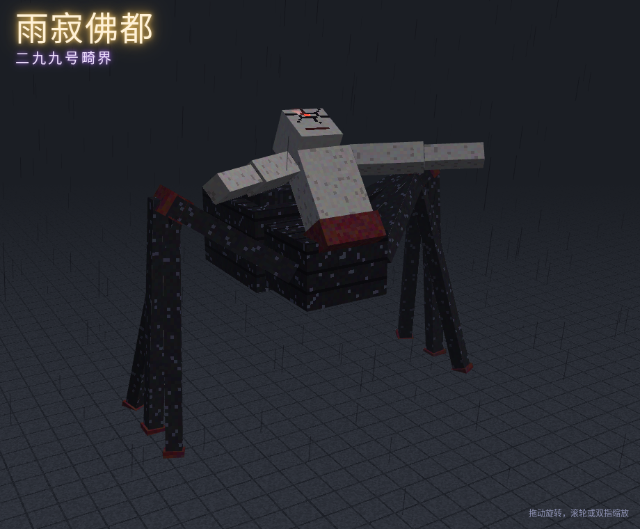 | 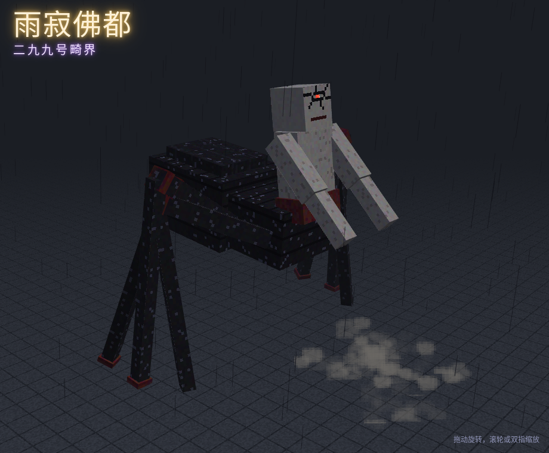 |

> 四五层楼高的漆黑六足节肢巨物，前部嵌着一个健壮男人的上半身，额心怒睁一只佛眼。谁打了它，它就追谁追过半座城。

| 项 | 值 |
|---|---|
| 注册 ID | `qihai:chennu` |
| 对应十恶业 | 意业 · 嗔恨 |
| 对标原版 | 5 只铁傀儡 |
| 生命值 | 500 |
| 伤害 | 普通 20；践踏 30 |
| 移速 | 0.38（很快） |
| 护甲 | 15 |
| 碰撞箱 | 4.5 × 6（进不了狭窄的地方） 格 |
| 刷怪蛋颜色 | 底色 `#18161A`，斑点 `#D22818` |
| 来源标注 | 原著 |

### 机制

- 中立：不被攻击时不主动追人，只会践踏 4 格内的玩家。
- 记仇：一旦被某名玩家攻击，就把他设为永久目标，追踪范围 96 格，无视其他所有生物，直到那名玩家死亡或离开 128 格。
- 践踏：前足抬起砸地，半径 4 格造成 30 点伤害并击飞。
- 体型巨大：碰撞箱 4.5 × 6 格，进不了门洞、小巷和室内。
- 抗性：击退免疫；弹射物伤害减半，爆炸伤害加倍（原著里只有强烈爆炸能炸开它的甲壳）。
- 开启生物破坏时，奔跑会撞碎玻璃和树叶。

### 原著依据

约四至五层楼高的漆黑巨型节肢体，六条细长粗硬的节肢腿（不是八足蜘蛛），黑油亮甲壳，前部融合一个裸体健壮男性上半身，额心怒睁佛眼纹，眼周黑色放射裂纹。步幅大、移动飞快，腿能击穿混凝土；对攻击者极度记仇，会连续追出大片城区。被强烈爆炸炸过的尸体腹甲有熔蚀裂孔。（第143、155、188、197、212章）

### 美术资源

| 资源 | 内容 |
|---|---|
| 模型 | `geo/chennu.geo.json`：20 根骨骼、34 个方块；贴图 256×256，带发光层 |
| 动画 | `idle` 待机；`walk` 六足疾行；`stomp` 践踏；`roar` 被激怒；`death` 死亡 |
| 攻击 / 技能特效 | 践踏 第 0.6 秒：冲击尘环（`dust_ring`）；被激怒 第 0.4 秒：佛眼红光（`eye_glow`） |
| 音效 | 巨足落地（`chennu/step.ogg`，0.8 秒）；怒吼（`chennu/roar.ogg`，2.85 秒）；践踏（`chennu/stomp.ogg`，1.9 秒）；崩塌（`chennu/death.ogg`，3.2 秒） |

---

## 13. 十佛头（Ten-Faced Buddha）

| 外观 | 动作 |
|---|---|
| 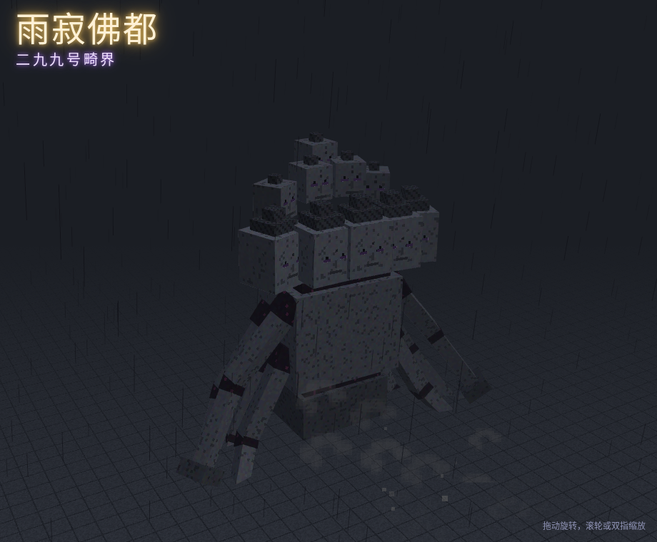 | 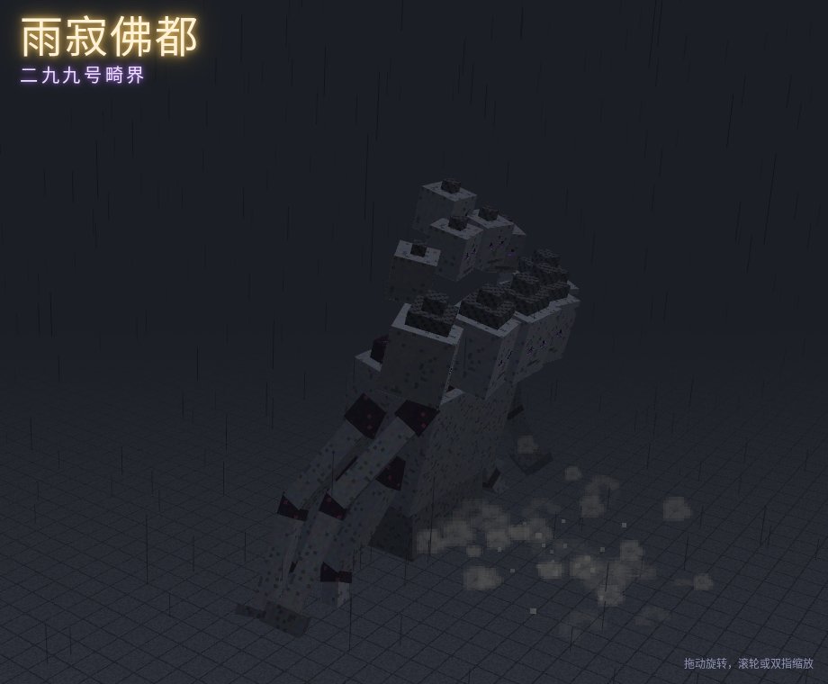 |

> 灰黑石皮的巨物，顶着五张大佛面和五张小佛面，关节处露出湿润蠕动的黑色血肉。它用八条石柱般的巨臂在竖井和高楼之间攀行。

| 项 | 值 |
|---|---|
| 注册 ID | `qihai:shifotou` |
| 对应十恶业 | 十恶业之上（最终存在） |
| 对标原版 | 奇界最终 Boss |
| 生命值 | 2000 |
| 伤害 | 巨臂砸地 50 + 冲击波 20；横扫 40；碾压每秒 10 |
| 移速 | 0.30（巨臂拖行，可攀墙） |
| 护甲 | 30 |
| 碰撞箱 | 6 × 8 格 |
| 刷怪蛋颜色 | 底色 `#5C5C60`，斑点 `#3A1830` |
| 来源标注 | 原著外形 + 二创数值 |

### 机制

- 极高减伤：所有伤害只结算 10%，爆炸结算 30%；免疫火焰、摔落、窒息；击退免疫。
- 巨臂砸地：四条前臂一齐砸下，落点 50 点伤害，并产生半径 6 格、20 点伤害的冲击波。
- 横扫：转身横扫，40 点伤害。
- 攀墙：可以抓着墙面向上爬，在高楼外墙和竖井中移动。
- 十面同视（二创）：每 20 秒，十个佛头同时转向目标，目标获得 3 秒黑暗与缓慢 III。
- Boss 血条；这一版只做刷怪蛋，召唤条件后续再做。

### 原著依据

远大于人，巨肢能摧毁地下螺旋通道并在建筑之间攀行；五个较大佛面和五个较小佛面，共十头；粗重的灰黑色石质外壳，发髻状凸起，眼部极深的黑暗质感；关节处露出湿润蠕动的黑色活组织；约七到八条巨臂，像石柱一样猛抽、撑墙攀爬；巨掌上有与偷盗怪相近的残缺法轮纹。（第200、201、206、209、210章）

### 美术资源

| 资源 | 内容 |
|---|---|
| 模型 | `geo/shifotou.geo.json`：29 根骨骼、69 个方块；贴图 256×256，带发光层 |
| 动画 | `idle` 待机；`crawl` 巨臂拖行；`slam` 巨臂砸地；`sweep` 横扫；`gaze` 十面同视；`climb` 攀墙；`death` 倒塌 |
| 攻击 / 技能特效 | 巨臂砸地 第 0.8 秒：冲击尘环（`dust_ring`）；巨臂砸地 第 0.82 秒：碎石（`stone_debris`）；待机 第 1.5 秒：黑色渗液（`black_ooze`）；十面同视 第 0.6 秒：佛眼红光（`eye_glow`）；倒塌 第 1.2 秒：冲击尘环（`dust_ring`） |
| 音效 | 石磨声（`shifotou/grind.ogg`，3.4 秒）；巨臂砸地（`shifotou/slam.ogg`，3.0 秒）；十面同视（`shifotou/gaze.ogg`，5.75 秒）；倒塌（`shifotou/death.ogg`，5.7 秒）；Boss 战曲（`shifotou/music_battle.ogg`，48.9 秒） |

---

## 14. 骨刺（Bone Spike）

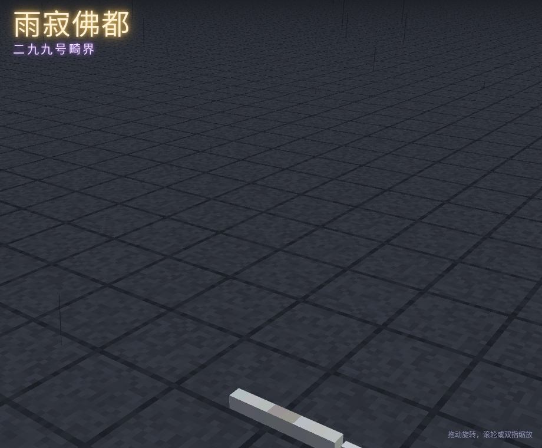

> 恶口怪齐射的白色骨刺。命中造成 3 点伤害，扎进方块后留存 10 秒。

| 项 | 值 |
|---|---|
| 注册 ID | `qihai:bone_spike` |
| 对应十恶业 | 恶口怪的远程攻击 |
| 对标原版 | — |
| 生命值 | — |
| 伤害 | 3 |
| 移速 | 弹射物 1.6 |
| 护甲 | — |
| 碰撞箱 | 0.25 × 0.25 格 |
| 来源标注 | 原著 |

### 机制

- 飞行时绕轴旋转；扎进方块后停止并留存 10 秒。

### 原著依据

恶口怪遭挑衅或开枪后齐射的大量尖锐白骨刺，可扎入墙面与人的肩部。（第142、188章）

### 美术资源

| 资源 | 内容 |
|---|---|
| 模型 | `geo/bone_spike.geo.json`：2 根骨骼、2 个方块；贴图 32×32 |
| 动画 | `fly` 飞行 |

---

## 15. 特效与刷怪蛋


从左到右：愚痴、杀生、偷盗、恶口、妄语、两舌、邪淫、绮语、贪欲、嗔怒、十佛头。

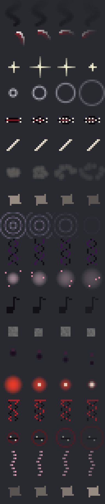

| 特效 | 文件 | 用于 |
|---|---|---|
| 业力黑烟 | `particles/karma_wisp.json`，`textures/particle/karma_wisp_0..3.png` | 愚痴怪 |
| 刀光 | `particles/blade_slash.json`，`textures/particle/blade_slash_0..3.png` | 杀生怪 |
| 抢夺闪光 | `particles/snatch_glint.json`，`textures/particle/snatch_glint_0..3.png` | 偷盗怪 |
| 尖啸声波 | `particles/scream_ring.json`，`textures/particle/scream_ring_0..3.png` | 偷盗怪 |
| 咒骂口纹 | `particles/curse_glyph.json`，`textures/particle/curse_glyph_0..3.png` | 恶口怪 |
| 骨刺碎片 | `particles/bone_shard.json`，`textures/particle/bone_shard_0..3.png` | 恶口怪 |
| 冲击尘环 | `particles/dust_ring.json`，`textures/particle/dust_ring_0..3.png` | 十佛头、嗔怒怪 |
| 人皮碎屑 | `particles/skin_flake.json`，`textures/particle/skin_flake_0..3.png` | 贪欲怪 |
| 拟声涟漪 | `particles/voice_ripple.json`，`textures/particle/voice_ripple_0..3.png` | 妄语怪 |
| 离间扭纹 | `particles/discord_twist.json`，`textures/particle/discord_twist_0..3.png` | 两舌怪 |
| 甜腻香雾 | `particles/sweet_haze.json`，`textures/particle/sweet_haze_0..3.png` | 邪淫怪 |
| 墨色音符 | `particles/ink_note.json`，`textures/particle/ink_note_0..3.png` | 绮语怪 |
| 碎石 | `particles/stone_debris.json`，`textures/particle/stone_debris_0..3.png` | 十佛头 |
| 黑色渗液 | `particles/black_ooze.json`，`textures/particle/black_ooze_0..3.png` | 十佛头 |
| 佛眼红光 | `particles/eye_glow.json`，`textures/particle/eye_glow_0..3.png` | 十佛头、嗔怒怪 |
| 众叛红纹 | `particles/betray_mark.json`，`textures/particle/betray_mark_0..3.png` | 两舌怪 |
| 咒缚光环 | `particles/curse_aura.json`，`textures/particle/curse_aura_0..3.png` | 恶口怪 |
| 牵引丝线 | `particles/lure_pull.json`，`textures/particle/lure_pull_0..3.png` | 邪淫怪 |
| 吞噬人皮 | `particles/skin_absorb.json`，`textures/particle/skin_absorb_0..3.png` | 贪欲怪 |

每个特效都是 4 帧 16×16 的粒子贴图，按原版粒子格式提供了 `particles/*.json`；机制侧注册同名粒子类型即可。`data/cues.json` 记录了每个动作在第几秒触发哪个特效、从哪根骨骼发出。

---

## 16. 音乐与环境音

| 文件 | 时长 | 说明 |
|---|---|---|
| `sounds/shifotou/music_battle.ogg` | 48.9 秒 | Boss 战曲：低频持续音、每四拍一记重鼓、每 12 秒一声寺钟、中段有不协和的箫声旋律；首尾淡入淡出，可循环 |
| `sounds/ambience/rain.ogg` | 30.0 秒 | 奇界环境音：黑雨和远处的钟声 |

所有音效都是程序合成的原创声音（单声道、44.1 kHz、Vorbis），已写好 `sounds.json` 和中英文字幕。妄语怪的“熟人的呼唤”、绮语怪的箫声建议之后由社区录真人声或真箫替换，效果会好很多。

---

## 17. 资源包结构与接入

```
yuji_fodu_monsters/
├── monster_cards.md
├── images/
├── data/            model_stats.json、cues.json、eggs.json
└── assets/qihai/
    ├── geo/                    12 个模型
    ├── animations/             12 个动画文件
    ├── textures/entity/        实体贴图 + 发光层（嗔怒怪、十佛头）
    ├── textures/item/          11 个刷怪蛋
    ├── textures/mob_effect/    3 个状态效果图标
    ├── textures/particle/      76 张特效帧
    ├── particles/              19 个粒子定义
    ├── sounds/                 47 个音效 + 战曲 + 环境音
    ├── sounds.json
    ├── models/item/、items/    刷怪蛋物品模型
    └── lang/                   zh_cn.json、en_us.json
```

- GeckoLib 4（1.20.1）：`geo/` 和 `animations/` 目录直接对应，动画名为 `animation.<模型名>.<动作>`。
- 渲染：除绮语怪（长袍下摆有镂空像素）外都是不透明贴图，用实体镂空渲染类型即可；嗔怒怪的佛眼和十佛头的眼部用 GeckoLib 自动发光层。
- 体型：十佛头按 1 倍导出约 8 格高，如果想更有压迫感，可以在渲染器里整体放大到 1.25–1.5 倍，碰撞箱同步放大。
- 偷盗怪的 `loot` 骨骼用于在手上渲染偷到的物品；贪欲怪的 `layer_1`–`layer_3` 骨骼对应三层可剥落的人脸，剥落后在渲染器里隐藏对应骨骼。

---

## 18. 二创与待定

| 内容 | 说明 |
|---|---|
| 绮语怪的外形与能力 | 原著只有箫声，本体从未露面；外形参考第 187–188 章壁画的“花语/颌颈纹”意象二创 |
| 十佛头的“十面同视” | 二创技能，原著没有 |
| 所有数值 | 生命、伤害、移速、减伤比例都是按你给的对标标准设计的，原著没有数值 |
| 黑雨 / 普通雨两种状态 | 原著里黑雨会把危险等级抬高，这一版没做，留给刷新机制 |
| 十佛头召唤条件 | 你提的“击杀所有种类并达到一定数量后出现”，下一版和刷新机制一起做 |
| 未核实章节 | 资料里有 19 章没能核实（122、124–125、133–136、147–150、157–159、161、163、165、167、207），不能排除这些章节里有补充设定 |